# Siraazhi Pro POS — Official User Manual & Operations Guide
**Vanur Farmer Producer Company Limited (VFPC Ltd)**  
*Cold-Pressed Oil Manufacturing & Retail Point of Sale System*

---

## Welcome to Siraazhi Pro POS

Welcome to the **Siraazhi Pro POS** User Manual! This guide is written in simple, clear English to help cashiers, store assistants, inventory managers, and accountants use every feature of the software with ease and confidence.

Whether you are billing cold-pressed groundnut oil at the counter, crushing a fresh batch of sesame seeds in the mill, or preparing your monthly GST tax reports for your Chartered Accountant, this manual will show you exactly what to do step by step.

---

## Quick Navigation (Table of Contents)

1. [System Overview & Starting Up](#1-system-overview--starting-up)
2. [Chapter 1: The Executive Dashboard](#chapter-1-the-executive-dashboard)
3. [Chapter 2: Counter Sales & Fast Checkout](#chapter-2-counter-sales--fast-checkout)
4. [Chapter 3: Multiple Active Bills (Hold Cart)](#chapter-3-multiple-active-bills-hold-cart)
5. [Chapter 4: Inventory & Stock Management](#chapter-4-inventory--stock-management)
6. [Chapter 5: Oil Production & Batch Crushing](#chapter-5-oil-production--batch-crushing)
7. [Chapter 6: Raw Material Purchases](#chapter-6-raw-material-purchases)
8. [Chapter 7: Daily Shop Expenses & Overheads](#chapter-7-daily-shop-expenses--overheads)
9. [Chapter 8: Invoices Register, Reprints & Protected Cancellations](#chapter-8-invoices-register-reprints--protected-cancellations)
10. [Chapter 9: GST Tax Filing & GSTR-1 Excel Exports](#chapter-9-gst-tax-filing--gstr-1-excel-exports)
11. [Chapter 10: Shop Settings & Printer Configuration](#chapter-10-shop-settings--printer-configuration)
12. [Chapter 11: Mobile Staff Wi-Fi Billing & Print Queue](#chapter-11-mobile-staff-wi-fi-billing--print-queue)
13. [Chapter 12: Automatic Safety Backups & Data Protection](#chapter-12-automatic-safety-backups--data-protection)
14. [Appendix A: Keyboard Shortcut Cheat Sheet](#appendix-a-keyboard-shortcut-cheat-sheet)
15. [Appendix B: Frequently Asked Questions & Troubleshooting](#appendix-b-frequently-asked-questions--troubleshooting)

---

## 1. System Overview & Starting Up

### What is Siraazhi Pro POS?
Siraazhi Pro POS is an offline, desktop-first point-of-sale software engineered specifically for **Vanur Farmer Producer Company Ltd (VFPC)**.
- **100% Offline:** Works without an active internet connection. All sales and inventory are stored safely on your counter computer.
- **Master Computer vs. Mobile Terminals:**
  - **Master Counter Computer:** Located at the cash desk. Has full access to everything: billing, inventory edits, purchases, expenses, and settings.
  - **Mobile Staff Phones / Tablets:** Connected over the shop's local Wi-Fi. Staff can scan items and bill customers in the aisles in **Restricted Staff Mode** without seeing financial profit margins or modifying product prices.

### How to Start the System Every Morning
1. Turn on your counter PC.
2. Double-click the **Siraazhi Pro POS** icon on your Desktop.
3. The software opens automatically in a clean, full-screen window ready for your first customer.
4. If you close the window by mistake during the day, simply double-click the Desktop icon again—it re-opens in one second without losing any data.

---

## Chapter 1: The Executive Dashboard

When you open Siraazhi Pro POS, the first screen you see is the **Executive Dashboard**. It gives the store manager an instant summary of today's business.

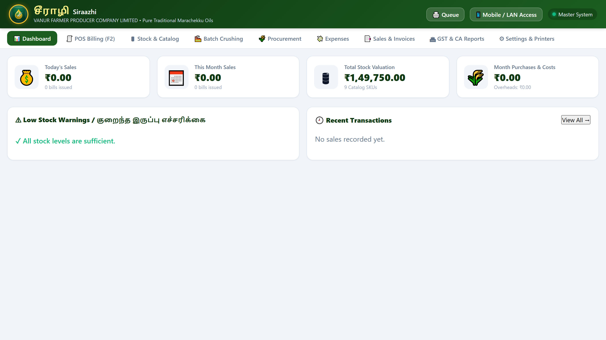

### What You See on the Dashboard:
1. **Today's Revenue:** Total money collected from sales today.
2. **Invoices Count:** How many bills were issued today.
3. **Total Inventory Value:** The total monetary worth of all finished oils, seeds, and byproducts currently in stock.
4. **Low Stock Warnings:** A quick counter alerting you if any oil bottles or raw materials are running dangerously low.
5. **Quick Launch Buttons:** Fast shortcuts to jump straight to:
   - **New Bill (`F2`):** Go directly to the counter checkout screen.
   - **Add Stock:** Jump to the inventory catalog to update stock.
   - **Log Production:** Record a new oil crushing batch.
   - **GSTR-1 Tax Report:** View monthly tax summaries.

---

## Chapter 2: Counter Sales & Fast Checkout

The **Billing Counter** is where your cashiers spend most of their day. It is designed to be lightning-fast, easy to operate with a touch screen, mouse, or keyboard, and completely bilingual (Tamil & English).

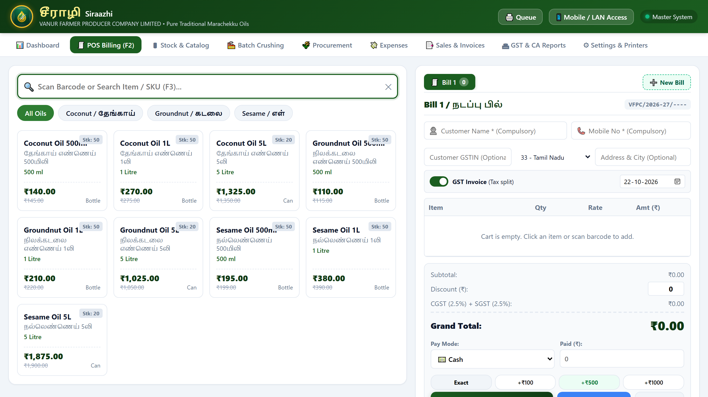

### Step-by-Step Billing Instructions:

#### Step 1: Add Items to the Cart
You can add products using any of these 3 easy methods:
1. **Click or Tap the Product Card:** Simply click any product on the screen (e.g., *Groundnut Oil 1L / நிலக்கடலை எண்ணெய்*). Each click adds 1 bottle.
2. **Scan the Barcode:** Point your handheld barcode scanner at the bottle's label. The product is immediately added to the bill.
3. **Use the Search Bar (`F2` or `F3`):** Press `F2` on your keyboard, type the name (e.g., "Sesame" or "எள்") or SKU code, and press `Enter`.

#### Step 2: Adjust Quantity or Apply Discount
In the **Active Cart** panel on the right side:
- Click **[+]** to increase the quantity.
- Click **[-]** to decrease the quantity.
- Click the red **Trash Can** icon to remove an item.
- **Bill Discount:** Enter a discount amount in rupees (₹) if you are giving a special promotional discount to the customer.

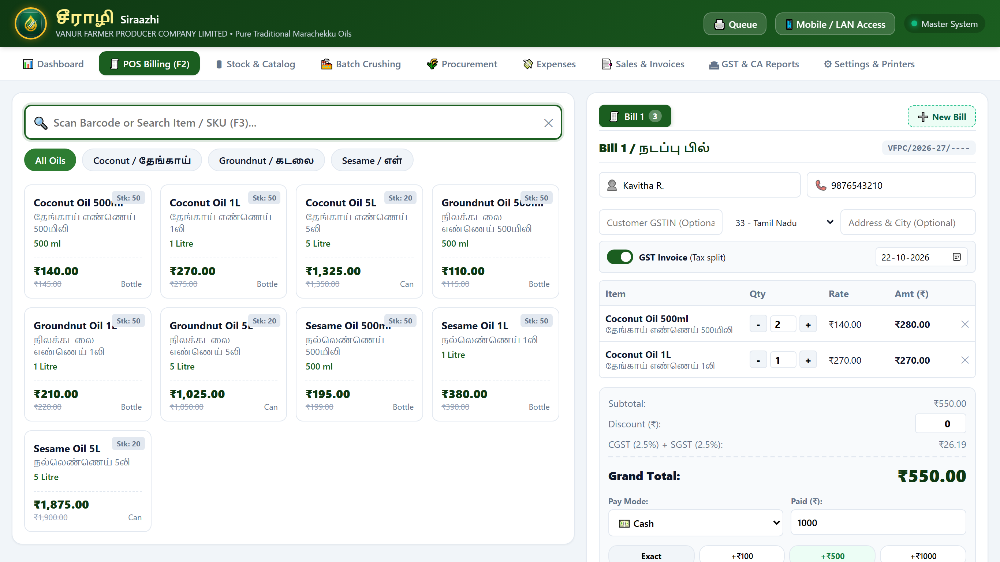

#### Step 3: Select Invoice Type (GST vs. Cash Memo)
At the top of the cart, you will find the **Tax Invoice Toggle** (or press `F4` on your keyboard):
- **Green Toggle ON (GST Tax Invoice):** The bill prints as an official Tax Invoice with CGST (2.5%) and SGST (2.5%) broken down clearly. Use this whenever the customer requests a tax invoice or for wholesale buyers.
- **Gray Toggle OFF (Retail Cash Memo):** The bill prints as a clean Retail Cash Memo with zero tax lines.

#### Step 4: Enter Customer Details
- **Customer Name & Mobile Number:** Type the customer's name and 10-digit mobile number.
- **Wholesale / B2B GSTIN:** If the customer is a registered business buyer, enter their 15-digit GST number. The bill will automatically be classified under **Table 4A (B2B)** in your monthly GSTR-1 tax return.

#### Step 5: Receive Payment & Manual Cash Drawer Handling
Select the payment method:
- **Cash:** For physical rupee notes and coins.
- **UPI / GPay / PhonePe:** For QR code payments.
- **Card:** For credit/debit card swipe machine payments.
- **Credit:** For trusted regular customers taking items on account.

> [!IMPORTANT]
> **Manual Cash Drawer & Change Calculator:**  
> Siraazhi Pro POS is built specifically for stores with a standard manual cash drawer. To make sure cashiers never give the wrong change:
> 1. Use the **Quick Cash Buttons** (`Exact`, `+₹100`, `+₹500`, `+₹1000`) or type the exact cash handed over by the customer.
> 2. The green **Change Return Calculator** instantly displays the exact change in large, bold numbers (e.g., *Change Due: ₹80.00*).
> 3. Count the change from your manual cash drawer and hand it to the customer.

#### Step 6: Finalize & Print (`F10`)
Click the big green **Print Bill** button or press **`F10`** on your keyboard:
1. The invoice is saved permanently to the database.
2. Inventory stock levels for all billed items decrease automatically.
3. The thermal receipt prints immediately on your counter printer.
4. The cart resets and is instantly ready for your next customer!

---

## Chapter 3: Multiple Active Bills (Hold Cart)

Imagine you are scanning items for **Customer 1**, but they suddenly remember they need a 5-liter can of Sesame Oil from the shelf and walk away to fetch it. Meanwhile, **Customer 2** is waiting with one bottle of Groundnut Oil ready to pay.

**With Siraazhi Pro POS, you never have to cancel or delete Customer 1's cart!**

### How to Hold and Switch Between Bills:
1. Look at the top of the cart area. You will see tabs labeled **Bill #1**, **Bill #2**, etc., plus a **+** button.
2. Press **`F8`** (or **`Ctrl + N`**, or click the **[+]** button) to open a new, blank bill tab (e.g., **Bill #2**).
3. Scan and bill Customer 2, collect their payment, and print their receipt.
4. When Customer 1 returns with their additional can, simply click back on **Bill #1**.
5. All of Customer 1's items, customer details, and quantities are still right there!
6. Scan the additional can and finalize the bill.

---

## Chapter 4: Inventory & Stock Management

The **Inventory** tab lets you monitor all your finished goods, cold-pressed oils, packaging materials, and byproducts in real-time.

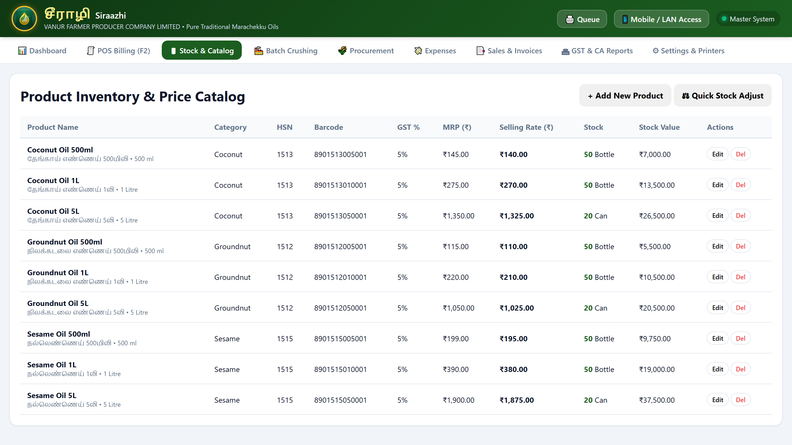

### Verified HSN Codes & GST Rates:
- **Groundnut Oil (நிலக்கடலை):** HSN `1512` — 5% GST (CGST 2.5% + SGST 2.5%)
- **Coconut Oil (தேங்காய்):** HSN `1513` — 5% GST (CGST 2.5% + SGST 2.5%)
- **Sesame Oil (எள் / நல்லெண்ணெய்):** HSN `1515` — 5% GST (CGST 2.5% + SGST 2.5%)

### Key Features of the Inventory Catalog:
- **Bilingual SKU Titles:** Displays both English and Tamil names (e.g., *Groundnut Oil 1L / நிலக்கடலை எண்ணெய்*).
- **Live Stock Levels:** Shows exact current stock in bottles, litres, or kilograms.
- **Visual Color Badges:**
  - **Green Badge:** Stock is healthy and available.
  - **Orange Alert Badge:** Stock is low (at or below reorder threshold).
  - **Red Badge:** Out of stock (0 bottles available).
- **Selling Price & GST Rate:** Clearly shows the retail price (including or excluding tax) and the applicable HSN code (e.g., HSN 1512 for Groundnut Oil at 5% GST).

### Adding a New Product:
1. Click the green **+ Add Product** button at the top right.
2. Fill in the details:
   - **SKU Code / Barcode:** e.g., `GNO-1L` or scan an existing barcode.
   - **Product Name:** e.g., `Sesame Oil 500ml / நல்லெண்ணெய் 500மி.லி`.
   - **Category:** Oil, Seed, Cake Byproduct, or Bottle.
   - **Selling Price (₹):** Retail price charged to customers.
   - **Cost Price (₹):** What it costs your company to manufacture or buy.
   - **HSN Code:** 4-digit or 8-digit GST classification code.
   - **GST Rate (%):** 5% for edible vegetable oils.
   - **Initial Stock:** Starting quantity on shelf.
   - **Low Stock Threshold:** Warning level (e.g., notify me when less than 10 remain).
3. Click **Save Product**.

### Performing a Stock Audit / Manual Adjustment:
If a bottle broke accidentally or was given out as a tasting sample:
1. Click the **Adjust** button next to the product in the table.
2. Choose **Subtract** (or **Add** if you found extra bottles during a physical count).
3. Enter the quantity and type a short reason (e.g., *Broken during shelf stocking*).
4. Click **Update Stock**. The inventory adjusts immediately and the audit note is logged.

---

## Chapter 5: Oil Production & Batch Crushing

Traditional cold-pressed oil production involves converting raw seeds (groundnut kernels, sesame seeds, dried copra) into pure filtered oil and valuable cattle-feed oilcake byproduct.

The **Production** tab tracks this exact milling lifecycle.

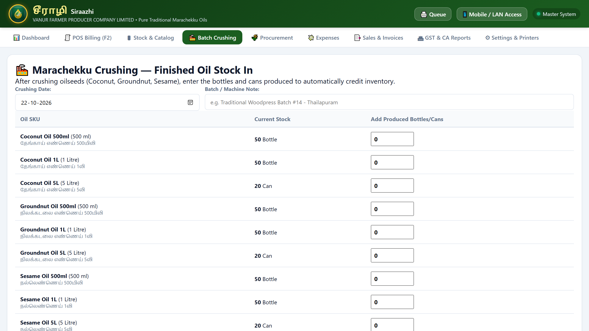

### How to Record an Oil Crushing Batch:
1. Click the **Production** tab in the main navigation.
2. Click **+ Log New Batch**.
3. Fill in the batch parameters:
   - **Date of Crushing:** Today's date.
   - **Raw Seed Used:** Select raw groundnut, sesame, or copra from your raw material inventory.
   - **Seed Input Weight (Kg):** Total kilograms loaded into the crushing machine (e.g., `100.00 kg`).
   - **Finished Oil Yield (Litres):** Total pure oil extracted (e.g., `42.50 L`).
   - **Oilcake Byproduct (Kg):** Total cake recovery produced for cattle feed (e.g., `55.00 kg`).
   - **Operator / Mill Notes:** Machine number or operator name.
4. Click **Save Batch**.

### What Happens Automatically:
- Raw seed stock is deducted from your raw inventory.
- Finished oil stock is automatically credited into your shelf inventory.
- Oilcake stock is credited so it can be sold to dairy farmers.
- The system calculates your **Crushing Yield Percentage** (e.g., 42.5% oil recovery) to help you monitor extraction efficiency!

---

## Chapter 6: Raw Material Purchases

To manufacture premium cold-pressed oil, Vanur Farmer Producer Company purchases raw groundnut seeds, sesame seeds, copra, and packaging bottles from local farmer members and packaging vendors.

The **Purchases** tab records all procurement transactions.

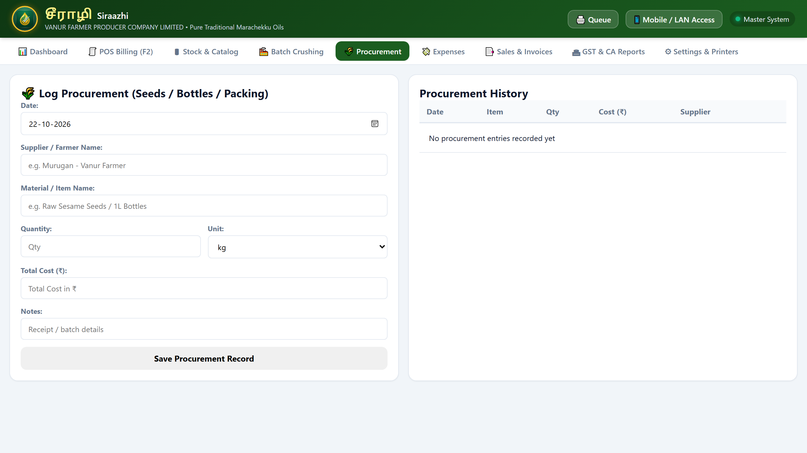

### How to Log a Purchase:
1. Go to the **Purchases** tab and click **+ Add Purchase**.
2. Enter the supplier details:
   - **Supplier / Farmer Name:** e.g., *Ramasamy Farmer Group, Vanur*.
   - **Supplier Contact & GSTIN:** Optional contact number and GST number.
   - **Invoice / Receipt Number:** The bill number given by the farmer or supplier.
   - **Item Purchased:** e.g., *Raw Groundnut Pods (Grade A)* or *1-Litre Pet Bottles*.
   - **Quantity & Rate:** e.g., `500 kg` at `₹82.00/kg`.
   - **Total Amount Paid & Payment Mode:** Cash, Bank Transfer / NEFT, or Cheque.
3. Click **Save Purchase**.
4. Raw stock quantities update instantly.

---

## Chapter 7: Daily Shop Expenses & Overheads

A profitable retail store must track everyday operating costs. The **Expenses** tab lets you record day-to-day shop overheads so your store manager and board of directors can see exact net profitability.

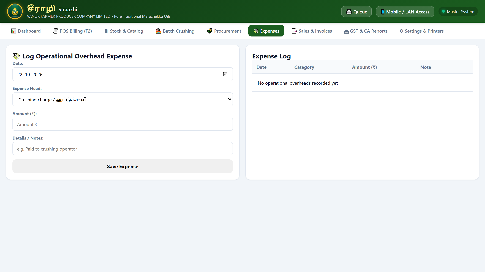

### Common Expense Categories Supported:
- **Labour & Wages:** Daily mill operator wages, helper wages.
- **Electricity & Power:** Monthly electricity bills for the crushing mill.
- **Freight & Transport:** Vehicle diesel or tempo hire to transport seeds from farm to store.
- **Packaging & Consumables:** Tape, labels, carry bags.
- **Tea & Refreshments:** Daily staff refreshments.
- **Maintenance & Spares:** Machine lubrication, belt replacements, cleaning supplies.

### Recording an Expense:
1. Open the **Expenses** tab.
2. Click **+ Add Expense**.
3. Select the **Category**, enter the **Amount (₹)**, choose **Payment Mode** (Cash/UPI), and type a short description (e.g., *Diesel for delivery van*).
4. Click **Record Expense**.

---

## Chapter 8: Invoices Register, Reprints & Protected Cancellations

The **Bills / Sales History** tab is your permanent transaction register. Every bill ever generated is archived here with its full item breakdown, timestamp, payment method, and cashier details.

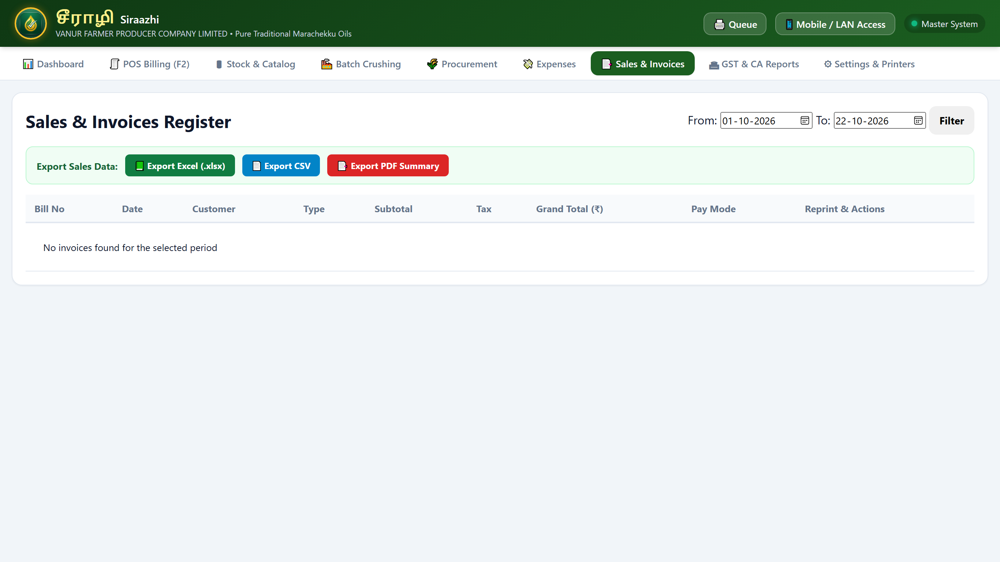

### 1. Searching for Past Invoices
- Type a customer name, phone number, or bill number (e.g., `VFPC-1042`) into the search bar.
- Use the date pickers to view sales for any specific date range (e.g., yesterday, this week, or last month).

### 2. Viewing & Reprinting Bills
- Click the blue **View** button next to any bill to see the full on-screen receipt.
- Need to hand the customer another copy? Click **Reprint** and choose your desired format (**80mm Thermal**, **58mm Thermal**, or **A4 Corporate Invoice**).

### 3. Master PIN Protected Bill Cancellation
Mistakes happen—a cashier might select the wrong payment method or ring up an order that the customer decided to return before walking out.

To protect the store against unauthorized bill deletions:
1. Click the red **Cancel Bill** button next to the invoice.
2. The system prompts for the **Master PIN** (default: `1234`).
3. Enter the reason for cancellation (e.g., *Customer changed mind before payment*).
4. Click **Confirm Cancellation**.

> [!IMPORTANT]
> **Automatic Stock Restoration:**  
> When a bill is cancelled, Siraazhi Pro POS **immediately returns all items from that bill back into your live stock**. You never have to manually adjust inventory after a cancellation!

---

## Chapter 9: GST Tax Filing & GSTR-1 Excel Exports

At the end of every month, your Chartered Accountant (CA) or tax consultant needs sales figures to file your official GST returns. Siraazhi Pro POS does all the math for you with one click!

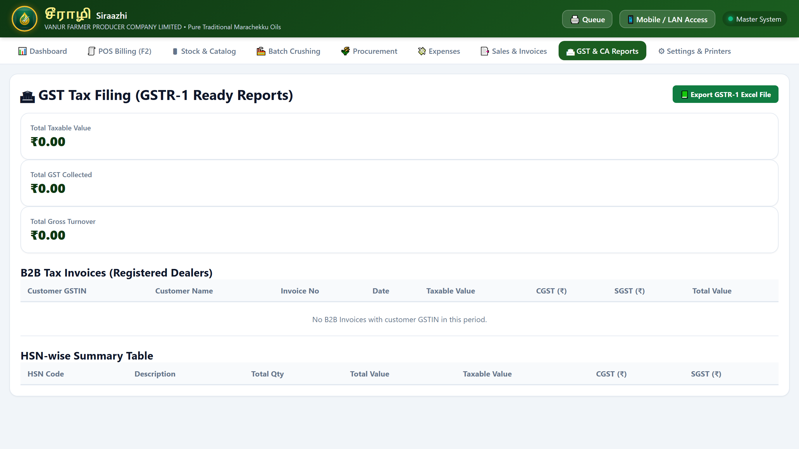

### Understanding the GSTR-1 Sections:
- **Table 4A — B2B Taxable Invoices:** Sales made to registered business buyers with their 15-digit GSTIN recorded on the bill.
- **Table 7 — B2C Small Retail Sales:** Everyday walk-in retail sales to consumers without a GSTIN, grouped cleanly by tax rate (5%).
- **Table 12 — HSN Summary:** Total quantity in litres/kg and total tax collected for each HSN code (e.g., HSN 1512 Groundnut Oil, HSN 1513 Coconut Oil, HSN 1515 Sesame Oil).
- **Document Summary:** Total number of invoices issued, cancelled, and net valid bills during the period.

### How to Export for Your Accountant:
1. Open the **GSTR-1 Reports** tab.
2. Select the start and end dates (e.g., `01/10/2026` to `31/10/2026`).
3. Click **Export to Excel (.xlsx)**.
4. The file downloads directly to your PC. Email or WhatsApp this Excel sheet straight to your Chartered Accountant—it is pre-formatted to match the official GST offline filing tool!

---

## Chapter 10: Shop Settings & Printer Configuration

The **Settings** tab lets you customize your company profile and configure your hardware receipt printers.

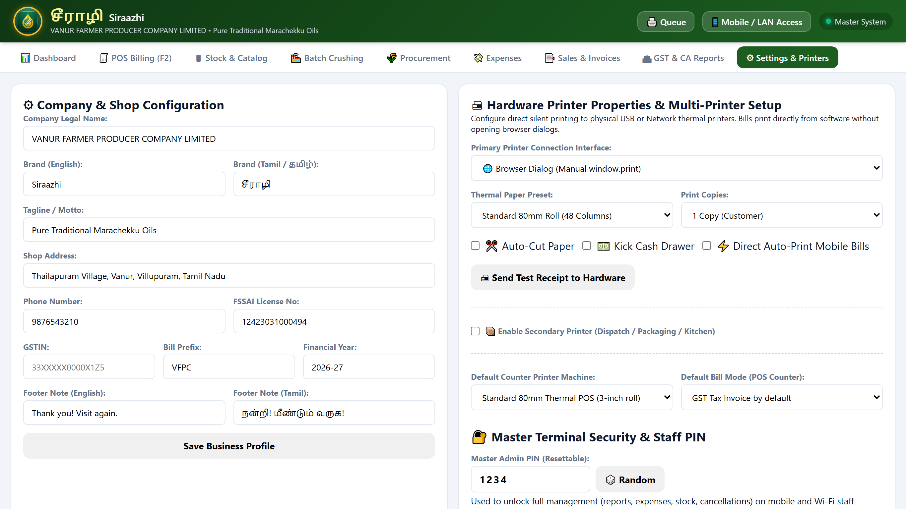

### 1. Store Profile & Legal Information
Fill in your official business details:
- **Company Name:** Vanur Farmer Producer Company Limited (VFPC Ltd)
- **Tagline / Subheading:** Cold-Pressed Virgin Edible Oils
- **Address & District:** Vanur, Villupuram District, Tamil Nadu - 604102
- **Store Contact Numbers:** Phone numbers displayed at the top of every receipt.
- **GSTIN Number:** Your official 15-character GST identification number.
- **FSSAI License Number:** Mandatory 14-digit food safety registration number (printed on all food packaging receipts).
- **Invoice Prefix:** e.g., `VFPC-` (bills will be numbered `VFPC-1001`, `VFPC-1002`, etc.).

### 2. Multi-Printer Engine Configuration
Select your default printer format based on your hardware:
- **80mm Thermal Receipt (Standard 3-Inch POS Roll):** Recommended for counter checkout. Fast, compact, and economical. Compatible with TVS, Epson, Xprinter, NGX, POSIFLEX, and generic thermal printers.
- **58mm Thermal Receipt (Compact 2-Inch Roll):** Ideal for portable handheld Bluetooth printers or tight counter spaces.
- **A4 Corporate Tax Invoice:** Prints full-page legal invoices on laser or inkjet printers with letterhead, bank account details for RTGS/NEFT, and signature blocks.
- **A5 Delivery Slip:** Half-page compact delivery note.
- **Direct PDF Generator:** Saves invoices as crisp vector PDF files directly in your Downloads folder—perfect for sending to customers over WhatsApp!

---

## Chapter 11: Mobile Staff Wi-Fi Billing & Print Queue

During festival seasons, harvest fairs, or busy weekend hours, one cashier counter may not be enough. With Siraazhi Pro POS, your sales assistants can use their own **Android smartphones, iPhones, or tablets** as mobile billing terminals over the shop's Wi-Fi router!

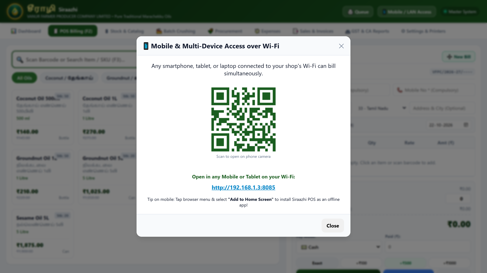

### How to Connect Mobile Devices:
1. Make sure your Master PC and the staff smartphones are connected to the **same shop Wi-Fi network**.
2. On the Master PC, click the **📱 Mobile / LAN Access** button at the top of the screen.
3. A large QR code appears on the screen with your local shop address (e.g., `http://192.168.1.3:8080`).
4. Have your staff open their phone camera or QR scanner and scan the QR code.
5. The mobile billing interface opens instantly in their mobile browser!
6. **Optional App Icon:** In Chrome or Safari on the phone, tap **"Add to Home Screen"**. The POS will now launch in full-screen mode just like a native mobile app!

### Role Security: Master PC vs. Restricted Staff Mode
To keep your store secure:
- **Mobile Staff Mode:** Staff can ONLY search products, scan barcodes, and create bills. They **cannot** delete bills, alter product prices, view company expenses, or export database backups.
- **Master Admin Unlock:** The business owner can enter the **Master PIN** (`1234`) on any mobile device if they need full administrative access while away from the counter.

### Centralized Thermal Print Queue
What happens when a staff member completes a sale on their phone while standing with a customer in aisle 3?

- The mobile phone automatically sends the print job over Wi-Fi to the **Central Print Queue** on the Master PC.
- The Master PC counter printer prints the thermal receipt immediately!
- The customer can simply walk to the counter, show their bill number, pay cash or UPI, and collect their receipt and packed bottles without waiting in a long line.

---

## Chapter 12: Automatic Safety Backups & Data Protection

Your sales history, customer records, and inventory data are vital assets of your business. Siraazhi Pro POS is designed with military-grade safety systems to ensure you never lose a single transaction.

### 1. Automatic Daily Rolling Snapshots
Every day when the software is launched, it automatically creates a complete backup snapshot of your database in the `data/backups/` folder:
- `pos_auto_YYYYMMDD.db` (e.g. `pos_auto_20261022.db`)
- The system automatically retains the last 14 days of daily snapshots and checks database integrity every 12 hours.
If Windows ever crashes or suffers a power surge, your data is completely intact.

### 2. Manual Backup to USB Pendrive (Recommended Weekly)
Every Saturday evening, take a 10-second manual backup:
1. Insert a USB pendrive into your counter computer.
2. Go to the **Settings** tab in Siraazhi Pro POS.
3. Click **Download Database Backup (.db)** or **Download JSON Backup**.
4. Save the file directly onto your USB pendrive and keep it in a safe place.

### 3. Restoring on a New Computer
If you ever buy a new computer:
1. Copy your `siraazhi-pos.exe` file and your `data/pos.db` backup to the new computer.
2. Double-click `siraazhi-pos.exe`.
3. All your products, stock levels, past invoices, and settings will appear immediately!

---

## Appendix A: Keyboard Shortcut Cheat Sheet

Keep this quick reference card beside your counter keyboard for high-speed operation:

| Key Shortcut | Function | What It Does |
| :--- | :--- | :--- |
| **`F2`** | Focus Barcode / SKU Search | Instantly puts your cursor into the search box so you can scan or type without touching the mouse. |
| **`F3`** | Select & Replace Search | Highlights existing text in the search bar for the next quick lookup. |
| **`F4`** | Toggle GST Tax Mode | Switches instantly between **GST Tax Invoice (with CGST/SGST)** and **Retail Cash Memo (Zero Tax)**. |
| **`F8`** or **`Ctrl + N`** | Add New Bill Tab (Hold Cart) | Opens a new transaction tab without clearing the previous customer's cart. |
| **`F10`** | Save & Print Bill | Finalizes the active cart and sends the print job straight to your receipt printer. |
| **`Esc`** | Close Popup / Cancel | Closes open dialog windows, customer dropdown, or clears search boxes. |
| **`Ctrl + P`** | Browser Print | Opens the standard Windows printer selection dialog if you need to choose an alternate printer. |

---

## Appendix B: Frequently Asked Questions & Troubleshooting

### Q1: The thermal receipt printer is not printing anything.
- **Check Paper:** Open the printer lid and ensure the paper roll is not empty and is inserted with the heat-sensitive side facing up.
- **Check Cables:** Make sure the USB cable connecting the printer to the PC is plugged in securely.
- **Check Default Windows Printer:** In Windows Settings -> *Printers & Scanners*, verify that your thermal printer is set as the default printer.

### Q2: A mobile phone says "Connection Timed Out" when scanning the QR code.
- **Same Wi-Fi Network:** Verify that the mobile phone is connected to your shop's Wi-Fi router, not mobile data (4G/5G).
- **Windows Firewall:** If this is the first time connecting, Windows Defender Firewall may display a prompt asking to allow network communication. Click **"Allow Access on Private Networks"**.

### Q3: How do I change the Master PIN?
- Go to the **Settings** tab on the Master PC, locate the **Security & Access PIN** section, enter your new 4-digit PIN, and click **Save Settings**.

### Q4: Can I use this software when there is a power cut?
- Yes! If your counter PC is connected to a standard UPS or inverter, or if you run the software on a laptop, Siraazhi Pro POS runs 100% offline without needing internet.

---

**Vanur Farmer Producer Company Limited (VFPC Ltd)**  
*Thailapuram Village, Vanur, Villupuram District, Tamil Nadu — 604102*  
*FSSAI Lic. No: 12423031000494 | Helpline & Support: +91 98765 43210*
